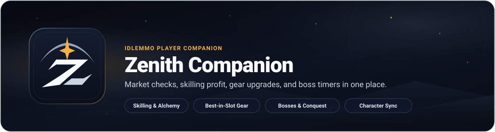
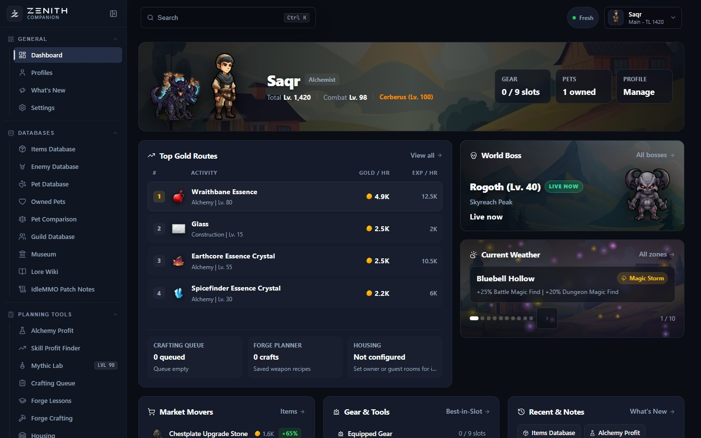
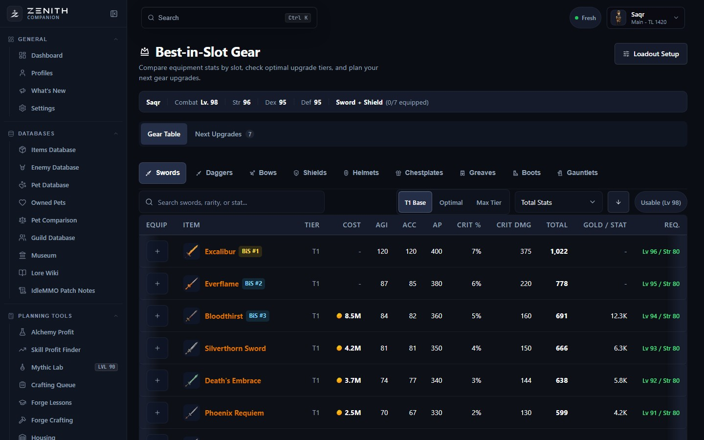
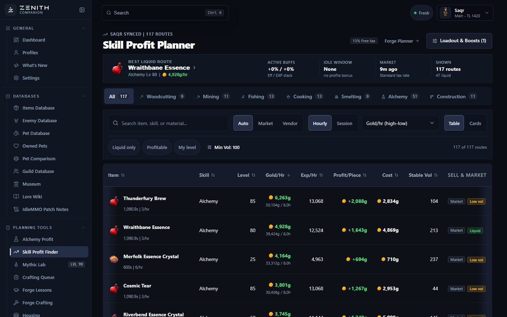
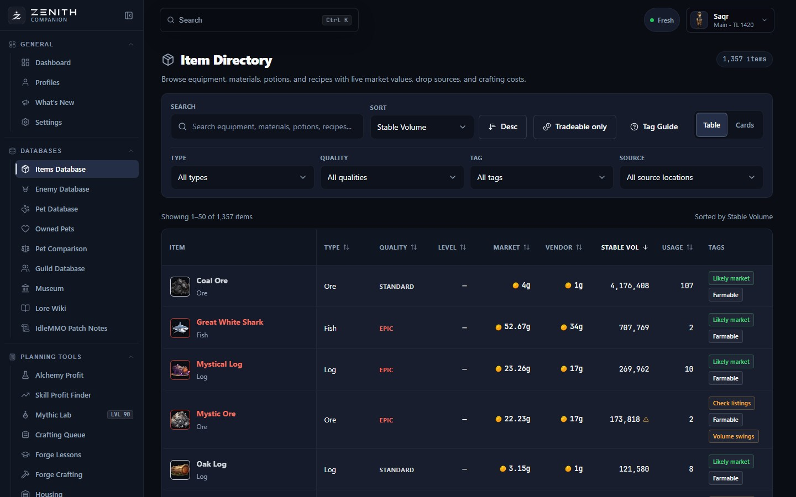
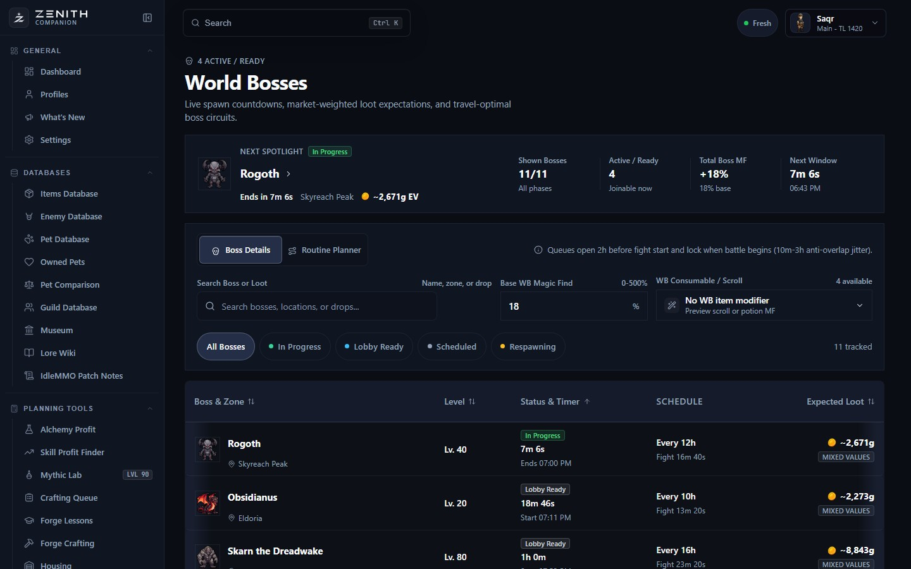
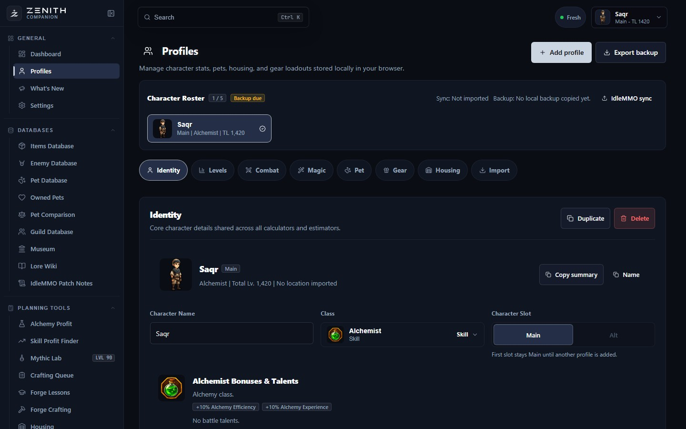
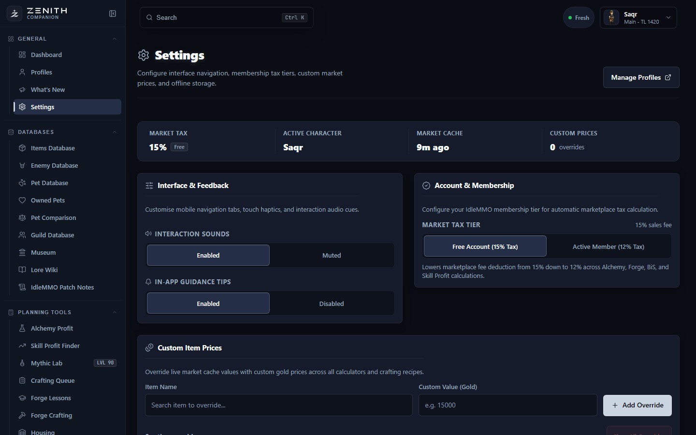
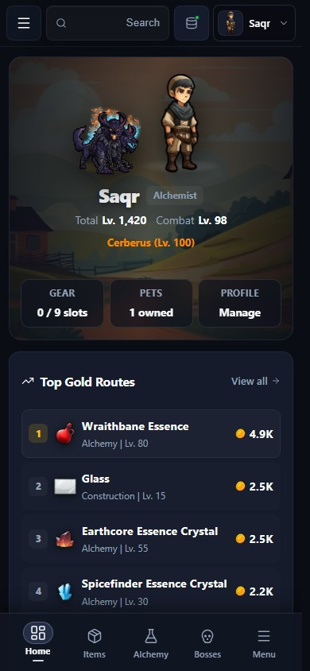

<div align="center">
  <a href="https://zenith-companion.vercel.app">
    
  </a>

  <p>
    <a href="https://zenith-companion.vercel.app"><strong>Open the Website</strong></a>
    &nbsp;&nbsp;|&nbsp;&nbsp;
    <a href="CHANGELOG.md"><strong>Changelog</strong></a>
    &nbsp;&nbsp;|&nbsp;&nbsp;
    <a href="https://github.com/DevMohammed52/Zenith-Companion/issues"><strong>Report a Bug</strong></a>
  </p>
</div>

Zenith Companion is an open-source companion site I built for IdleMMO. It brings market prices, item drops, pet stats, guild activity, and your character stats into one place so you can plan skilling routes, check gear upgrades, and time world bosses without guessing in spreadsheets.

<p align="center">
  
</p>

<p align="center">
  
  
</p>

<p align="center">
  
  
</p>

<details>
<summary>More screenshots: Profiles, Settings, and Mobile</summary>

<br />

<p align="center">
  
  
</p>

<p align="center">
  
</p>

</details>

## What you can do with it

**Plan crafting and skilling**

* Compare gold per hour, EXP per hour, and recent trade volume across repeatable gathering, smelting, cooking, construction, and alchemy routes.
* Plan Lv 1–89 alchemy batches and Lv 90 mythic crafts with membership tax, bartering discounts, break-even prices, and in-bank stock deductions.
* Track forge crafting costs, Temper Shard yields, and housing buffs, or swap stats temporarily with What-If loadouts without changing your saved character.

**Check gear, combat, and bosses**

* Compare weapons and armour across all 9 slots (`T1` through `Max Tier`) sorted by stats, cost, or gold per stat, plus quick next-upgrade picks for your level.
* Review enemy drops, dungeon entry costs and shard returns, and live world boss timers with a travel-order circuit planner.

**Browse items, pets, guilds, and lore**

* Look up any item (`1,357` indexed) to see vendor prices, recent purchase-order values, liquidity warnings, drop sources, recipes that use it, and related lore notes.
* Track all `47` pets, compare battle curves, browse `1,663` guilds, follow Conquest territories and zone weather, check Museum collections, and search IdleMMO patch notes.

**Keep your data in your browser**

* Profiles, custom item prices, and crafting queues stay stored locally in your browser unless you export a backup file.
* You never need to paste an IdleMMO API key into the site. Importing a character uses your public character hash.

## Running it locally

If you want to run or modify a copy on your own machine (`Node.js 24+`):

```bash
git clone https://github.com/DevMohammed52/Zenith-Companion.git
cd Zenith-Companion
npm install
npm run dev
```

Add `IDLEMMO_API_KEY` to `.env` only if you plan to run the data update scripts yourself (`npm run scrape` or `npm run idlemmo:discover`). Run checks with `npm run test:unit` and `npm run typecheck`.

## Notes

This is an unofficial fan project and is not affiliated with IdleMMO. Market values, guild stats, and boss timers come from periodic snapshots, so always double-check live in-game prices before big trades.

Built by [DevMohammed52](https://github.com/DevMohammed52) with help and feedback from IdleMMO players. IdleMMO assets and game data belong to their respective owners.
